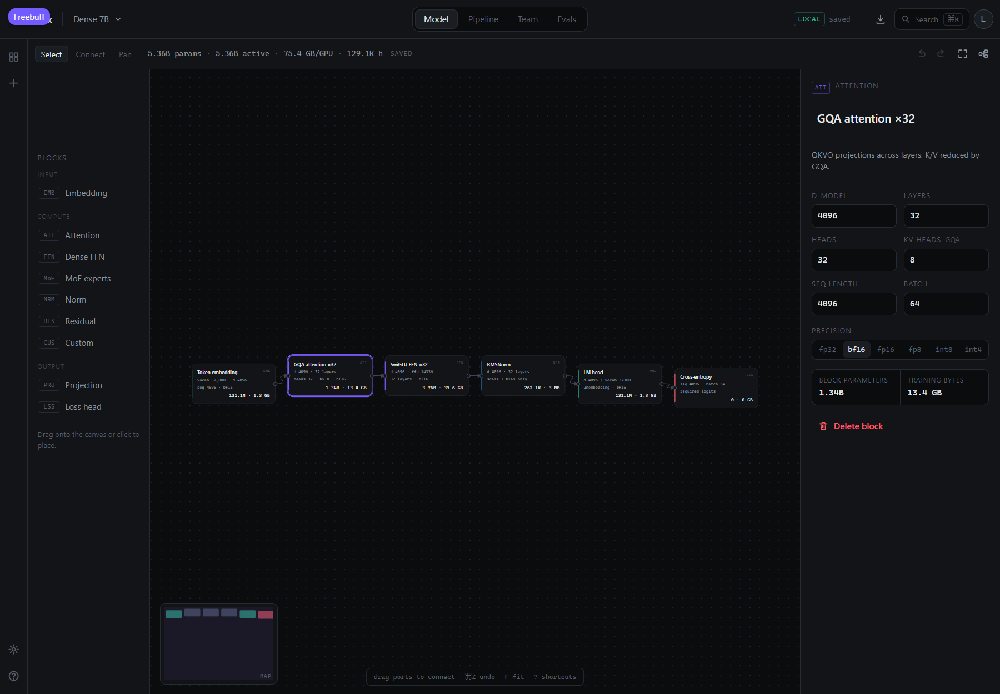

# Rack

Plan the run before you run it.

Rack is a per-account workspace for planning a language-model training run in one place: the
architecture graph, the schedule that gets it trained, and the people and compute behind it. Three
views stay linked to a single project, so changing an expert count updates the parameter totals, the
GPU-hours and the cost that the rest of the plan is built on.

It is a small, dependency-light web app: React + Vite on the client, a Hono Worker on the server,
D1 for storage, and Sign in with Freebuff for accounts.



## What it does

**Model canvas** — build an architecture from typed blocks (embedding, attention, dense FFN, MoE
router, expert group, norm, residual, projection, loss head, custom). Drag from the palette, connect
port to port, pan and zoom. Every block card shows its parameter and memory cost, and the header
totals update live as the inspector changes `d_model`, layers, heads, KV heads, FFN width, experts,
top-k, vocab, sequence length, batch or precision. Connecting two ports that would create a cycle is
refused with a red edge and a toast rather than a silent failure. 50 levels of undo/redo, ⌘D to
duplicate, arrow keys to nudge, `F` to fit, and an auto-layout pass.

**Pipeline** — six swimlanes (Data → Pretrain → SFT → Preference tuning → Eval → Deploy). Bars move
and resize by the week, snap to weeks, carry their compute estimate, and show dependency arrows, a
today line and week/month/quarter zoom.

**Team** — roles with headcount and monthly rate, plus a per-stage allocation grid. Allocations are
capped at 100% per role, and capacity and cost roll up from them.

**Evals** — coverage and readiness derived from the gate table, so "are we ready to ship?" is a number
instead of a feeling.

**Dashboard** — project cards with stage, model size, team count, next milestone and a progress
sparkline. New projects start from three templates (dense 7B, MoE 8×7B, and a small 1B eval-focused
seed).

Edits are saved per account in D1, debounced 800 ms after the last change, with a
saved / saving / offline indicator. A failed save is requeued and retried when the connection
returns, and every pending edit is mirrored to `localStorage` so a refresh mid-edit recovers it
instead of dropping it.

## Design

The interface follows a "lab console" system: near-black surfaces, hairline borders, one accent per
entity (model, data, training, eval, risk) used only as a 1 px border, dot or 2 px rail — never as a
fill. Monospace tabular numerals for anything numeric, a 24 px dot grid on the canvas, and motion
limited to 120 ms hovers, 200 ms panels and 320 ms view switches, all disabled under
`prefers-reduced-motion`. Keyboard focus is always a visible 2 px ring.

## Quick start

Requires [Bun](https://bun.sh) 1.2+ and Node 20+ (for the Vite toolchain).

```sh
bun install
bun run dev
```

Open the URL Vite prints (http://127.0.0.1:5173). The dev server runs the Worker and a local D1
database through `@cloudflare/vite-plugin` — no Cloudflare account, no database server, no
credentials.

On a loopback origin with no auth configuration, Rack uses a single clearly labelled local preview
identity (`local-preview`). That fallback never applies on a hosted origin or when auth config is
incomplete; there, requests are unauthenticated and `/api/projects` returns 401.

## Scripts

| Command | What it does |
| --- | --- |
| `bun run dev` | Vite dev server plus the Worker on a local D1 database |
| `bun run build` | Builds the client and the Worker, strips source maps from `dist/` |
| `bun run typecheck` | `tsc --noEmit` for the client and again for the Worker |
| `bun test` | Unit and HTTP-boundary tests on a real Miniflare D1 database |
| `bun run test:e2e` | 59-check browser suite over the DevTools Protocol |
| `bun x wrangler deploy --dry-run` | Verifies the Worker bundles with its D1 and asset bindings |

The browser suite needs `bun run dev` already running, and a Chrome or Edge install. Override the
targets with `BASE_URL` and `CHROME_PATH`:

```sh
BASE_URL=http://127.0.0.1:5173 CHROME_PATH="/path/to/chrome" bun run test:e2e
```

It drives real input — mouse, keyboard, wheel, network emulation — against the live app: 9 block
kinds, typed-port rejection, cycle feedback, undo depth, drag-and-resize snapping, allocation caps,
eval readiness, offline save and recovery, draft recovery across a mid-edit refresh, and a 760 px
overflow pass. Unit tests cover the estimate engine, the API (validation, owner scoping, exact
round-trip) and two-identity isolation at the HTTP boundary.

## Architecture

```
src/
  shared/
    estimate.ts     parameter, activation, memory and GPU-hour math; cycle detection
    templates.ts    the three seed architectures
    types.ts        types shared by client and server
  worker/
    index.ts        Worker entry: auth wrap, then the Hono app, then assets
    app.ts          routes, authorization, origin checks, body limits
    auth.ts         Sign in with Freebuff and the loopback-only preview identity
    db.ts           D1 schema, migrations and row mapping
    shape.ts        request validation
    seeds.ts        template construction
  client/
    App.tsx         shell, routing, autosave queue and drawer state
    Canvas.tsx      graph editing: drag, connect, marquee, undo, inspector
    Pipeline.tsx    timeline, snapping, dependencies, zoom
    Team.tsx        roles and stage allocations
    Evals.tsx       coverage, readiness and gates
    Dashboard.tsx   project grid and empty state
    drafts.ts       local draft mirror used for refresh recovery
    style.css       the design system in one file
tests/
  estimate.test.ts  math and cycle rules
  app.test.ts       API behaviour with injected identities
  isolation.test.ts two accounts over a real loopback HTTP server
  e2e/browser.mjs   the CDP browser suite
```

The same `src/shared/estimate.ts` runs in the browser and the server, so the totals on screen and the
numbers stored with a plan cannot drift apart.

## API

All project routes require a session. Mutations must be same-origin. Responses are
`Cache-Control: private, no-store`.

| Method | Route | Purpose |
| --- | --- | --- |
| `GET` | `/api/health` | Readiness probe |
| `GET` | `/api/session` | Current user, auth mode, database availability |
| `GET` | `/api/projects` | List the caller's projects with rollups |
| `POST` | `/api/projects` | Create from a template |
| `GET` | `/api/projects/:id` | Load one project and all its layers |
| `PATCH` | `/api/projects/:id` | Rename, re-stage or move the start date |
| `DELETE` | `/api/projects/:id` | Delete a project |
| `PUT` | `/api/projects/:id/graph` | Replace blocks and edges |
| `PUT` | `/api/projects/:id/plan` | Replace stages, roles and evals |
| `PUT` | `/api/projects/:id/settings` | Replace run settings |

Ownership is always the authenticated `sub`; ids are never trusted from the client for scoping.
Child rows are keyed by `(project_id, id)`, and the schema upgrades older databases in place on
first use.

## Data model

A project row holds name, brief, stage, start date and run settings. Its blocks, edges, stages,
roles and evals live in child tables keyed by the project, so one project's ids can never collide
with another's. Blocks carry a config object (`dModel`, `layers`, `heads`, `kvHeads`, `ffnWidth`,
`experts`, `topK`, `vocab`, `seqLen`, `batch`, `precision`); stages carry week ranges, an owner role
and dependencies; roles carry headcount, rate and a per-stage allocation map.

## Deploying

Rack targets Cloudflare Workers + D1. `deploy.json` describes the built Worker and static assets, and
`wrangler.jsonc` covers local development.

On Freebuff Sites, the site's tooling provisions D1 as `DB`, enables Sign in with Freebuff, and
injects `FREEBUFF_CLIENT_ID`, `FREEBUFF_ISSUER` and `APP_ORIGIN` at deploy time — no application
secret is stored in the repo. `APP_ORIGIN` is the canonical origin; it is never derived from a
request's `Host` header.

Vercel cannot host this app as built: the backend needs a D1 binding, the Workers runtime and the
Worker auth SDK. You would need to port the server (Hono on a Node function, Postgres instead of D1,
and a Node-capable session implementation) before a static host could run it end to end.

## Known limitations

- Hosted sign-in and cross-account isolation are unverified in this repo's test suite. Isolation is
  proven over a real HTTP server with injected identities; the Freebuff login flow requires a
  deployed origin and two real accounts.
- No realtime collaboration, sharing or comments yet.
- The pipeline stores week ranges, so dates follow the project start date rather than a calendar.

## Contributing

See [CONTRIBUTING.md](CONTRIBUTING.md). Issues and pull requests are welcome.

## License

[MIT](LICENSE).
